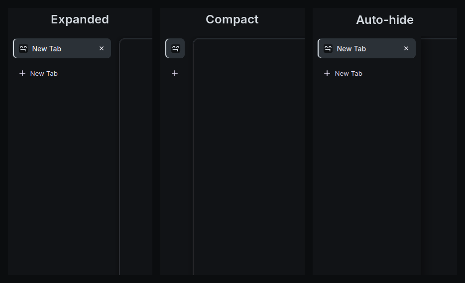

<p align="center">
  
</p>

<p align="center">
  <a href="#download"><b>Download</b></a> ·
  <a href="#whats-in-whisper">Features</a> ·
  <a href="#who-whisper-talks-to">Network</a> ·
  <a href="#roadmap">Roadmap</a> ·
  <a href="#honest-limits">Honest limits</a> ·
  <a href="#build-from-source">Build</a>
</p>

<p align="center">
  <a href="https://github.com/footprintsntrails/whisper-browser/actions/workflows/gecko.yml"></a>
</p>

Whisper is a quiet web browser built from Mozilla's Firefox source. Telemetry is removed when
Whisper is built, uBlock Origin is part of the browser, DNS is encrypted, and the tabs live on
the side in a calm dark interface. It does not promise to make you invisible; it just stops your
browser from talking about you.

> **Early development.** Whisper 0.1.0 is based on Firefox 159.0.1 and runs on Windows and
> Linux. macOS comes next.


<sub>Whisper on Linux. The pages are saved copies of Wikipedia (CC BY-SA 4.0).</sub>

## What's in Whisper

- ✅ **Its own browser.** Whisper's name, icon, About dialog and new tab page; its own profile
  folder, so it never touches a Firefox profile. On Windows the file details of every program
  file say Whisper, not Mozilla.
- ✅ **Telemetry removed at build time.** The health report, Normandy studies, the ping sender
  and data uploads are not built into Whisper at all, and a new profile gets no telemetry ID.
  Crash reporter, default-browser agent and sponsored content are off.
- ✅ **114 built-in settings, 49 of them locked.** Privacy defaults that ship inside the browser
  ([`0-whisper.js`](gecko/overlay/browser/components/whisper/0-whisper.js)), not a profile tweak
  you could lose. No welcome tour and no terms pop-up on first start.
- ✅ **uBlock Origin built in.** The version signed by Mozilla, pinned by its SHA-256, enabled from
  the first start, allowed in private windows, with its button on the toolbar.
- ✅ **Encrypted DNS.** DNS over HTTPS through Quad9.
- ✅ **A normal-looking browser to websites.** Whisper keeps Firefox's exact User-Agent and
  window geometry, so sites see an ordinary Firefox instead of a rare browser that stands out.
- ✅ **Tabs on the side, three ways.** Switch with **Ctrl+Alt+S** or the tab strip's right-click menu:

  

  - **Expanded:** a narrow panel with large tabs.
  - **Compact:** just the tab icons.
  - **Auto-hide:** out of the way until your pointer touches the left edge.
- ✅ **Signed automatic updates.** Firefox's own updater, pointed at Whisper: it downloads in the
  background and shows **Restart to update Whisper** in the menu. An update installs only if it
  is signed with Whisper's keys for its channel and is newer than what you run.
- ✅ **Installs for you only.** On Windows Whisper goes to your user folder without administrator
  rights, so updates never ask for permission. On Linux it installs into your home folder.
- ✅ **Brings your things along.** On the first start Whisper offers to import bookmarks, history,
  passwords and form history from Chrome, Edge, Brave, Opera, Vivaldi and Safari, and from
  Firefox, Zen, LibreWolf, Floorp and Waterfox profiles. Cookies only if you tick them. Everything
  is copied on your computer; nothing is uploaded.
- ✅ **A network test on every build.** CI starts Whisper with a fresh profile and records every
  host name it looks up; any name outside the [allowlist](gecko/network-allowlist.txt) fails the build.

## Download

| System | Download | |
|---|---|---|
| **Windows** 10 and 11, 64-bit | [**Whisper-Setup.exe**](https://github.com/footprintsntrails/whisper-browser/releases/latest/download/Whisper-Setup.exe) | Installs for you only, no administrator rights |
| Windows, no install | [whisper-windows-x86_64.zip](https://github.com/footprintsntrails/whisper-browser/releases/latest/download/whisper-windows-x86_64.zip) | Unzip and run `whisper.exe` |
| **Linux** x86_64 | [**whisper-linux-x86_64.tar.xz**](https://github.com/footprintsntrails/whisper-browser/releases/latest/download/whisper-linux-x86_64.tar.xz) | Unpack, then run `whisper/install.sh` |

Every file is listed in [`SHA256SUMS`](https://github.com/footprintsntrails/whisper-browser/releases/latest/download/SHA256SUMS);
check a download with `sha256sum -c SHA256SUMS --ignore-missing`.

### Whisper Canary

**Whisper Canary** is the newest build, published after every change that passes the tests.
It is for testing and can break. It installs next to Whisper with its own folder, profile and a
yellow icon, checks for updates every 5 minutes, and never shares updates with Whisper: each
accepts only updates signed for its own channel. Get it from the
[canary pre-release](https://github.com/footprintsntrails/whisper-browser/releases/tag/canary):
[Whisper-Canary-Setup.exe](https://github.com/footprintsntrails/whisper-browser/releases/download/canary/Whisper-Canary-Setup.exe)
for Windows, `whisper-canary-linux-x86_64.tar.xz` for Linux.

### The first start: Whisper is not code-signed yet

Windows cannot tell who made an unsigned file, so the first time it warns you. Check the download
against `SHA256SUMS` if you want to be sure, then:

- **Windows:** SmartScreen says "Windows protected your PC". Click **More info**, then **Run anyway**.
- **macOS** (once the macOS build is out): drag Whisper to Applications, then either open
  **System Settings → Privacy & Security** after the first try and click **Open Anyway**, or run
  `xattr -dr com.apple.quarantine /Applications/Whisper.app`, which removes the
  "downloaded from the internet" flag from Whisper only. Since macOS 15, right-click and **Open**
  no longer gets past the warning. Whisper will be signed ad hoc, as Apple silicon requires, but
  not notarized.

## Who Whisper talks to

On a first start Whisper contacts only these, and CI checks it on every build:

| Why | Hosts |
|---|---|
| Encrypted DNS | `dns.quad9.net` |
| Firefox's remote settings (certificate revocation, block lists) | `firefox.settings.services.mozilla.com` |
| Video plugins: OpenH264 and Widevine for DRM video, as in Firefox | `ciscobinary.openh264.org`, `update.googleapis.com`, `edgedl.me.gvt1.com`, `www.google.com` |
| uBlock Origin updates | `versioncheck-bg.addons.mozilla.org` |
| uBlock Origin filter lists | `ublockorigin.github.io`, `ublockorigin.pages.dev`, `cdn.jsdelivr.net`, `raw.githubusercontent.com`, `publicsuffix.org`, `pgl.yoyo.org`, `malware-filter.gitlab.io`, `malware-filter.pages.dev`, `curbengh.github.io` |
| Whisper's own updates | `footprintsntrails.github.io`, `github.com`, `release-assets.githubusercontent.com` |

No telemetry, studies, ads, location or push servers. Mozilla's update server is not contacted,
and web push notifications are off, so sites cannot notify you while they are closed.

## Updates

Whisper checks `https://footprintsntrails.github.io/whisper-browser/update/1/release/<system>/update.xml`
every 6 hours (Canary: every 5 minutes), downloads a new version in the background and offers
**Restart to update**. The updater installs it only if it is signed with one of Whisper's two
release certificates (the second is a rotation key kept apart), carries Whisper's update channel
and is newer than the running build; downgrades, replayed old updates and anything unsigned or
tampered with are refused. CI tests each of these cases on every build. A Linux install updates
itself when its folder is writable by you, which `install.sh` arranges.

## Uninstall

- **Windows:** Settings → Apps → Whisper → Uninstall. Whisper asks whether to delete your profile
  too; it is kept unless you say yes.
- **Linux:** `whisper/install.sh --uninstall` from the folder you unpacked, or `--uninstall --purge`
  to delete the profile too.

## Roadmap

**Stage 1: Whisper's own browser**

- [x] Built from Mozilla's source release for Windows and Linux, verified against Mozilla's signature
- [x] Telemetry removed at build time, no telemetry IDs
- [x] uBlock Origin built in
- [x] Network test on every build
- [x] Signed automatic updates, with a Canary channel for testing
- [x] Windows installer without administrator rights
- [x] Import from other browsers, including Firefox-based ones
- [ ] macOS: one universal app for Apple silicon and Intel, DMG, signed ad hoc, no notarization
- [ ] Faster builds with PGO and LTO

**Stage 2: Cast**

- [ ] The full Cast interface ([ideas from Zen and Vivaldi](docs/ROADMAP-UI.md)): spaces, tab
      stacks, split view, a theme editor
- [ ] Identities that keep work, home and shopping apart
- [ ] Protection against ClickFix, the "paste this into your terminal" scam
- [ ] Video plugins downloaded only when a page first asks for them
- [ ] Whisper Vault: your profile (history, cookies, passwords, cache) in an encrypted container,
      unlocked with your password at start, with a recovery key shown once and never stored

## Honest limits

Whisper can't make you invisible. Here is what it does not do, so you can decide what it is good for.

- **Your IP address is visible.** Sites and your network provider still see that you connect.
  Use a VPN or Tor if you need to hide that.
- **Your fingerprint is an ordinary Firefox's.** That is on purpose: Whisper blends in with
  Firefox users instead of making everyone identical, which would cost speed and break sites.
- **The default search engine is Google,** as in Firefox. Change it in Settings → Search.
- **Video plugins come from Google and Cisco,** as in Firefox, on the first start. Turning off
  "Play DRM-controlled content" in Settings stops the Widevine download from Google if you do not
  need Netflix-style video; OpenH264, used for video calls, still comes from Cisco.
- **Not code-signed yet,** so Windows warns on first start (see above).
- **Updates check GitHub,** so GitHub sees your IP address when Whisper looks for a new version.
- **The update keys live in GitHub's secret store** and sign in GitHub Actions. Moving signing
  to hardware keys that stay offline is planned.

## Build from source

Building Firefox takes about an hour on a 4-core machine and about 40 GB of disk. Whisper is
built from Mozilla's source tarball, checked against Mozilla's release signature, plus a short
series of patches and new files; nothing of Firefox is copied into this repository.

```sh
gecko/scripts/fetch-source.sh ~/whisper-gecko/dl
gecko/scripts/fetch-ubo.sh ~/whisper-gecko/dl
gecko/scripts/prepare.sh ~/whisper-gecko/dl/firefox-*.source.tar.xz \
  ~/whisper-gecko/dl/uBlock0@raymondhill.net.xpi ~/whisper-gecko/src linux-x86_64
cd ~/whisper-gecko/src && ./mach build && ./mach package
```

GitHub Actions builds Linux x86_64 and Windows x86_64 (cross-compiled with clang-cl, as Mozilla
does) on every push, then starts each build with a fresh profile and checks it.

| Path | What it is |
|---|---|
| `gecko/firefox.env` | Firefox version, SHA-512 of its source and Mozilla's release key fingerprint |
| `gecko/release.env` | Whisper's version, update channel, update host and certificate fingerprints |
| `gecko/ubo.env` | uBlock Origin version and SHA-256 |
| `gecko/mozconfigs/` | Build options |
| `patches/` | The changes to Firefox's own files, each saying what and why |
| `gecko/overlay/` | New files added to the Firefox tree: branding, settings, the Cast interface |
| `gecko/scripts/` | Fetch and verify sources, prepare the tree, the smoke and update tests |
| `gecko/network-allowlist.txt` | The only host names a first start may look up |
| `crates/xtask/` | Build tooling: icons, artwork, checks |
| `.github/workflows/` | Builds, tests and releases |

## Contributing

Bug reports, ideas and pull requests are welcome. Start with [CONTRIBUTING.md](CONTRIBUTING.md).
Please report security problems privately, as described in [SECURITY.md](SECURITY.md).

## Contributors

<table>
  <tr>
    <td align="center" width="180">
      <a href="https://github.com/footprintsntrails"><br><b>footprintsntrails</b></a><br>
      <sub>Creator</sub>
    </td>
    <td align="center" width="180">
      <a href="https://www.anthropic.com/claude"><br><b>Claude</b></a><br>
      <sub>by Anthropic · AI pair programmer</sub>
    </td>
  </tr>
</table>

## License

Whisper is licensed under the [Mozilla Public License 2.0](LICENSE), the same license as Firefox.
The MPL-2.0 covers the code, not the Whisper name and logo: forks should use their own name and
logo (section 2.3 of the license grants no trademark rights).

The Inter typeface is under the SIL Open Font License. uBlock Origin is GPLv3 and ships unmodified,
as signed by Mozilla. Firefox is a trademark of the Mozilla Foundation. Whisper is not affiliated
with or endorsed by Mozilla.
