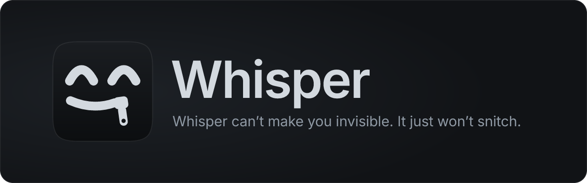
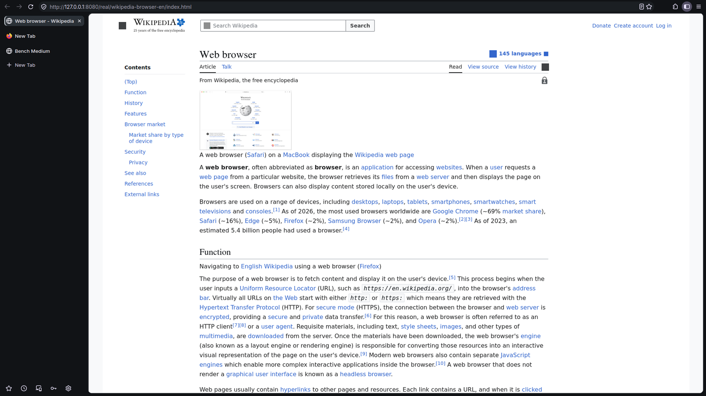

<p align="center">
  
</p>

<p align="center">
  <a href="#download"><b>Download</b></a> ·
  <a href="#what-whisper-does-today">Features</a> ·
  <a href="#roadmap">Roadmap</a> ·
  <a href="#honest-limits">Honest limits</a> ·
  <a href="#build-from-source">Build</a>
</p>

<p align="center">
  <a href="https://github.com/footprintsntrails/whisper-browser/actions/workflows/ci.yml"></a>
</p>

Whisper is a quiet browser built on Firefox. No telemetry, uBlock Origin from the first
minute, encrypted DNS and a calm dark look with the tabs on the side. It does not promise to
make you invisible; it just stops your browser from talking about you.

> **Prototype (stage 0).** Today Whisper is the Firefox you already have, running a separate
> Whisper profile that a small native launcher sets up and keeps up to date. Whisper's own build
> of Firefox is the next stage.



<sub>The prototype on Linux. The page is a saved copy of Wikipedia (CC BY-SA 4.0).</sub>

## What Whisper does today

- ✅ **Stays quiet.** Telemetry, studies, crash reports, sponsored tiles, Pocket, Safe Browsing
  lookups and speculative connections are off. Every line of [`profile/user.js`](profile/user.js)
  says what it turns off.
- ✅ **Blocks trackers and ads.** uBlock Origin, installed from addons.mozilla.org and signed by
  Mozilla, plus Firefox's tracking protection in Strict mode and Global Privacy Control.
- ✅ **Hides your DNS from the network.** DNS goes over HTTPS to Quad9.
- ✅ **Brings your things along.** Bookmarks, history and passwords from Firefox, Zen, LibreWolf,
  Floorp and Waterfox, and from Chrome, Edge, Brave, Opera, Vivaldi and Safari through Firefox's
  own import window. Everything is copied on your computer; nothing is uploaded anywhere.
- ✅ **Looks like Whisper.** Black and cool platinum, the Inter typeface, tabs on the left, the
  page in its own rounded panel ([`profile/chrome/userChrome.css`](profile/chrome/userChrome.css)).
- ✅ **Leaves your Firefox alone.** Whisper has its own profile; your normal Firefox profile,
  history and extensions are not touched.
- ✅ **Installs like an app.** A real installer for Windows, a disk image for macOS, .deb and .rpm
  packages and a tarball for Linux. Windows, macOS and the tarball need no administrator rights.
- ✅ **Updates itself, carefully.** Once a day, after the browser is already open. An update is
  installed only if its signature checks out.

## Roadmap

**Stage 1: Whisper's own build of Firefox**

- [ ] Telemetry code removed when Firefox is built, not just switched off
- [ ] uBlock Origin built in
- [ ] Signed releases end to end: Windows code signing, Apple notarization, signed updates
- [ ] A network test on every release that lists every server the browser contacts

**Stage 2: Cast**

- [ ] The full Cast interface: tabs on the side, every page in its own panel
- [ ] Spaces and identities that keep work, home and shopping apart
- [ ] Protection against ClickFix, the "paste this into your terminal" scam

## Download

| System | Download | |
|---|---|---|
| **Windows** 10 and 11 | [**Whisper-Setup.exe**](https://github.com/footprintsntrails/whisper-browser/releases/latest/download/Whisper-Setup.exe) | Installs for you only; no administrator rights |
| **macOS** 11 or later | [**Whisper.dmg**](https://github.com/footprintsntrails/whisper-browser/releases/latest/download/Whisper.dmg) | One app for Apple silicon and Intel |
| **Debian, Ubuntu, Mint** | [**whisper.deb**](https://github.com/footprintsntrails/whisper-browser/releases/latest/download/whisper.deb) | ARM64: [whisper-arm64.deb](https://github.com/footprintsntrails/whisper-browser/releases/latest/download/whisper-arm64.deb) |
| **Fedora, openSUSE** | [**whisper.rpm**](https://github.com/footprintsntrails/whisper-browser/releases/latest/download/whisper.rpm) | ARM64: [whisper-aarch64.rpm](https://github.com/footprintsntrails/whisper-browser/releases/latest/download/whisper-aarch64.rpm) |
| **Any Linux** | [**whisper-linux.tar.gz**](https://github.com/footprintsntrails/whisper-browser/releases/latest/download/whisper-linux.tar.gz) | Unpack, then `./whisper --install`. ARM64: [whisper-linux-arm64.tar.gz](https://github.com/footprintsntrails/whisper-browser/releases/latest/download/whisper-linux-arm64.tar.gz) |

Every file is listed in [`SHA256SUMS`](https://github.com/footprintsntrails/whisper-browser/releases/latest/download/SHA256SUMS).
To check a download: `sha256sum -c SHA256SUMS --ignore-missing` (Linux) or
`shasum -a 256 -c SHA256SUMS --ignore-missing` (macOS).

**Firefox.** Whisper runs on Firefox. If it is missing, Whisper on Windows and macOS offers to
download it from mozilla.org and installs it only after checking that it is signed by Mozilla.
On Linux, install Firefox from your package manager first; the native, Snap and Flatpak versions
all work.

### The first start: Whisper is not code-signed yet

Signing certificates from Microsoft and Apple come with stage 1. Until then your system warns you
the first time, and it is right to: it cannot tell who made the file. Check the download against
`SHA256SUMS` if you want to be sure, then:

- **Windows:** SmartScreen says "Windows protected your PC". Click **More info**, then **Run anyway**.
- **macOS:** drag Whisper to Applications. The first time, Control-click (or right-click) Whisper
  and choose **Open**, then **Open** again. Or try to open it once, then go to
  **System Settings → Privacy & Security** and click **Open Anyway**. Whisper is signed ad hoc but
  not notarized by Apple.
- **Linux:** `sudo apt install ./whisper.deb` or `sudo dnf install ./whisper.rpm`, or open the
  package with your software centre. The tarball needs nothing: `./whisper --install` puts Whisper
  in your home folder with a menu entry.

## Bringing your bookmarks and passwords

On the first start Whisper looks for other browsers on your computer and asks what to bring
over. You can do it again later with **Import from another browser** (Start menu on Windows,
the Whisper menu entry on Linux) or `whisper --import`; on macOS run
`open -a Whisper --args --import`.

- **Firefox, Zen, LibreWolf, Floorp, Waterfox:** Whisper copies bookmarks, history, passwords and
  form history from that browser's default profile. The other browser has to be closed, and the
  copy goes only into a new Whisper profile. Cookies come along only if you say yes; settings and
  extensions never do.
- **Chrome, Edge, Brave, Opera, Vivaldi, Chromium, Safari:** Whisper opens Firefox's own import
  window, which reads those browsers directly.

## Updates

- **Firefox** updates itself as usual, with Mozilla's signed updates.
- **uBlock Origin and its filter lists** update through Firefox.
- **Whisper** checks once a day, in the background, after the browser is already open. It fetches
  `update.json` and its signature from the latest GitHub release and verifies the signature with
  the key built into Whisper ([`keys/update-signing.pub.pem`](keys/update-signing.pub.pem),
  RSA-3072). Only then does it download the package for your system and check its SHA-256 against
  the signed list. The new version is used from the next start: on Windows the new installer runs
  silently, on macOS the new Whisper.app is unpacked next to the old one and swapped in, and a
  Linux install in your home folder is swapped the same way. A .deb or .rpm needs root to update,
  so Whisper shows a notification instead; install the new package to update.
- **Whisper's settings and theme** come with each version and are applied at every start. Put
  settings of your own in `user-overrides.js` in the Whisper profile folder; Whisper adds them
  after its own, so yours win.

To stop Whisper itself from going online (the daily check and the uBlock Origin download), set
`WHISPER_OFFLINE=1`, or create an empty file named `offline` in the Whisper folder:

| System | Whisper folder (profile, log, downloaded updates) |
|---|---|
| Windows | `%LOCALAPPDATA%\Whisper` |
| macOS | `~/Library/Application Support/Whisper` |
| Linux | `~/.local/share/whisper` (Snap Firefox: `~/snap/firefox/common/whisper`; Flatpak: `~/.var/app/org.mozilla.firefox/data/whisper`) |

## Honest limits

Whisper can't make you invisible. Here is what it does not do, so you can decide what it is good for.

- **Your IP address is visible.** Sites and your network provider still see that you connect.
  Use a VPN or Tor if you need to hide that.
- **Sites see a normal Firefox.** Whisper does not try to make every user look identical; your
  browser fingerprint is that of an ordinary Firefox.
- **The window says Firefox.** It is Firefox under the hood: the window title, the About dialog
  and the macOS Dock icon say Firefox. Whisper's own build will change that.
- **The default search engine is Firefox's.** Change it in Settings → Search.
- **Signing is partial.** Updates are signed with Whisper's own key, and the installers are
  checked against `SHA256SUMS`, but the installers are not code-signed by Microsoft or Apple yet
  and that one key lives in GitHub. Full signing comes with stage 1.
- **The daily check talks to GitHub.** GitHub sees your IP address once a day. Turn it off with
  `WHISPER_OFFLINE=1` if you prefer to update by hand.
- **Imports copy files.** If the other browser runs a much newer Firefox than yours, your Firefox
  may not be able to read what was copied.

## Uninstall

- **Windows:** Settings → Apps → Whisper → Uninstall. Tick the box to also delete your Whisper
  profile. From a script: `uninstall.exe /S`, or `uninstall.exe /S /PURGE` to delete the profile too.
- **macOS:** drag Whisper from Applications to the Bin. Your profile stays in
  `~/Library/Application Support/Whisper`; delete that folder to remove it too.
- **Linux:** `sudo apt remove whisper-browser` or `sudo dnf remove whisper-browser`. For the
  tarball install: `whisper --uninstall`, or `whisper --uninstall --purge` to delete the profile too.

## Build from source

You need [rustup](https://rustup.rs); the toolchain version is pinned in `rust-toolchain.toml`.

```sh
git clone https://github.com/footprintsntrails/whisper-browser
cd whisper-browser
cargo test --workspace --features whisper/test-hooks   # unit and end-to-end tests
cargo build --release -p whisper
cargo xtask bundle                                     # build/share and the profile bundles in dist/
cargo xtask tarball --bin target/release/whisper       # whisper-linux.tar.gz
cargo xtask help                                       # .deb, .rpm, Windows installer, disk image, …
```

To try a build without installing it, and without touching your real Whisper profile:

```sh
WHISPER_SHARE=build/share WHISPER_DATA=/tmp/whisper-try target/release/whisper
```

GitHub Actions builds every package on every push and installs it on Linux, Windows and macOS
runners with a stand-in for Firefox; see [`.github/workflows`](.github/workflows).

| Path | What it is |
|---|---|
| `crates/whisper/` | The `whisper` program: finds Firefox, sets up the profile, imports, updates |
| `crates/xtask/` | Build tooling: bundles, packages, icons, release manifest, checks |
| `profile/user.js` | Privacy and look settings, applied at every start |
| `profile/first-run-prefs.js` | The starting toolbar layout, copied into a new profile only |
| `profile/chrome/` | The Whisper theme and the Inter font |
| `packaging/` | Windows installer script, Linux desktop entry and package specs, macOS Info.plist |
| `keys/update-signing.pub.pem` | The public key that update signatures are checked against |
| `assets/` | Logo, icons and artwork (`cargo xtask icons`, `banner`, `installer-art`) |

## Contributing

Bug reports, ideas and pull requests are welcome. Start with [CONTRIBUTING.md](CONTRIBUTING.md).
Please report security problems privately, as described in [SECURITY.md](SECURITY.md).

## Contributors

<table>
  <tr>
    <td align="center" width="180">
      <a href="https://github.com/footprintsntrails"><br><b>footprintsntrails</b></a><br>
      <sub>Creator</sub>
    </td>
    <td align="center" width="180">
      <a href="https://www.anthropic.com/claude"><br><b>Claude</b></a><br>
      <sub>by Anthropic · AI pair programmer</sub>
    </td>
  </tr>
</table>

## License

Whisper is licensed under the [Mozilla Public License 2.0](LICENSE), the same license as Firefox.
The MPL-2.0 covers the code, not the Whisper name and logo: forks should use their own name and
logo (section 2.3 of the license grants no trademark rights).

The Inter typeface is under the SIL Open Font License ([`profile/chrome/fonts/OFL.txt`](profile/chrome/fonts/OFL.txt)).
uBlock Origin (GPLv3) is not part of Whisper; Whisper downloads it from addons.mozilla.org.
Firefox is a trademark of the Mozilla Foundation. Whisper is not affiliated with or endorsed by Mozilla.
